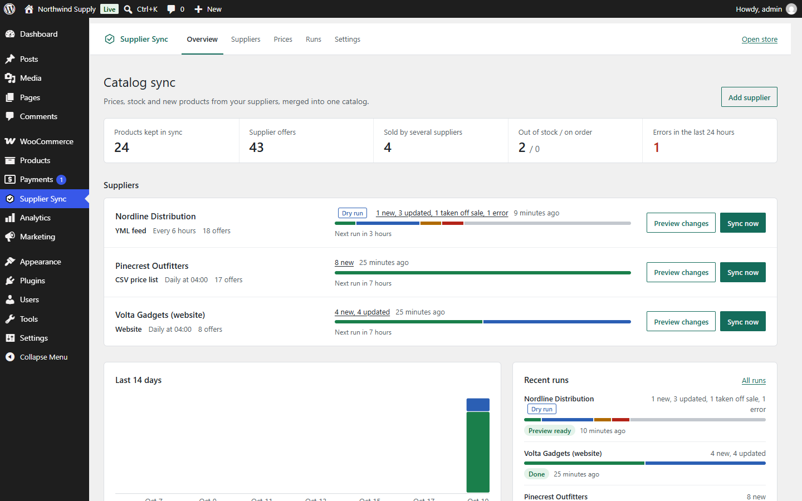
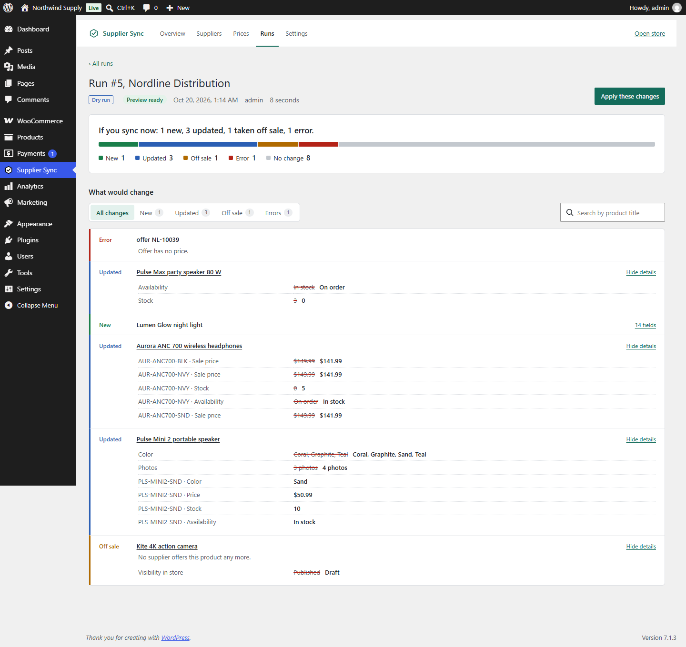
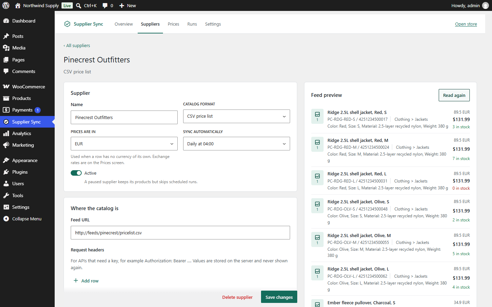
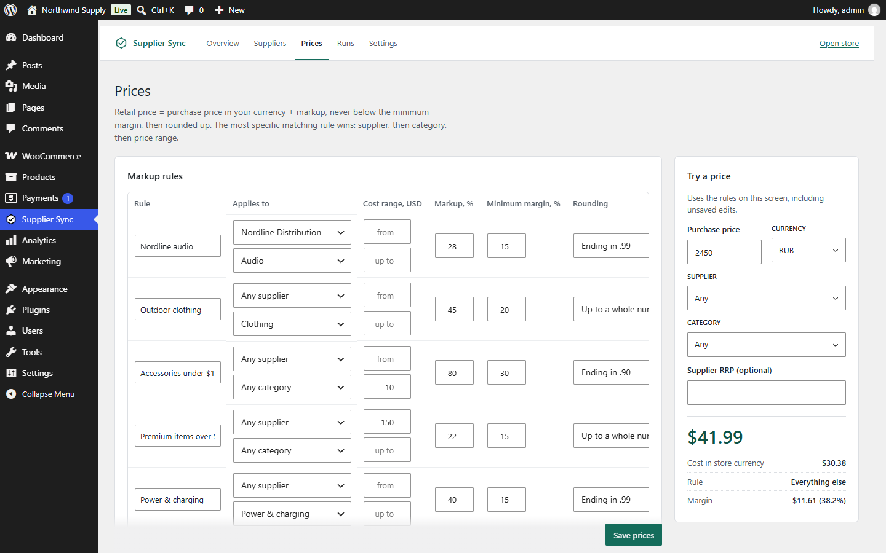
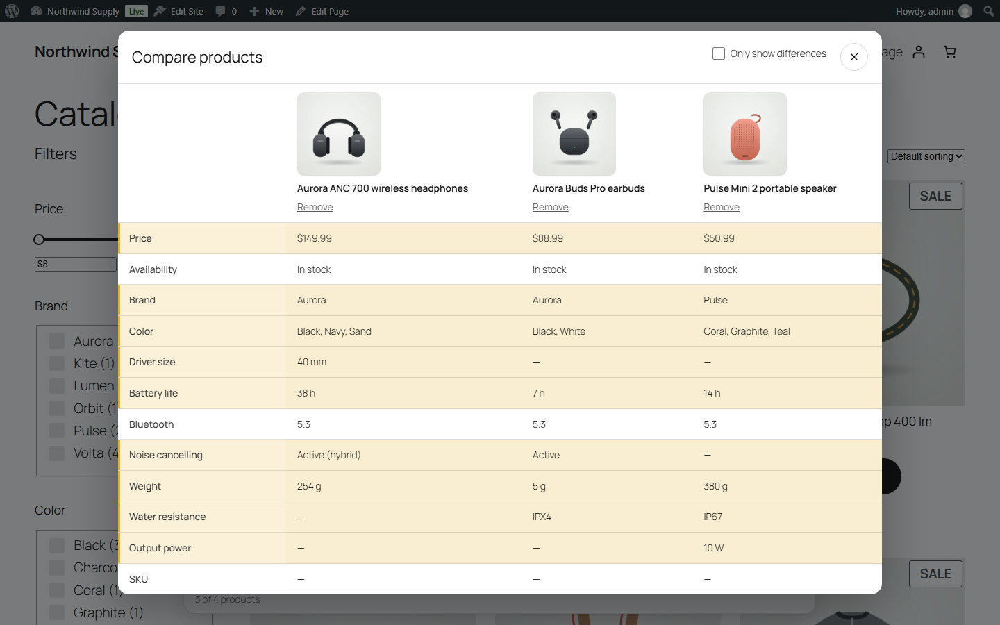
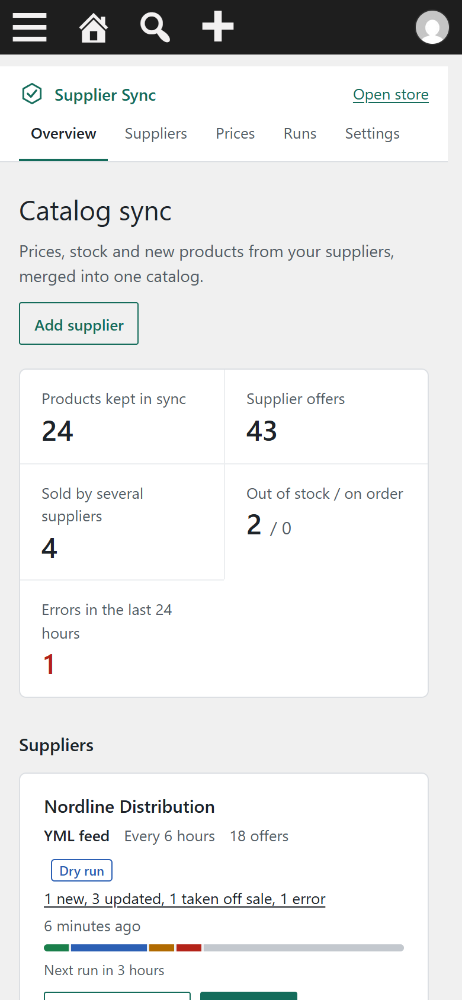
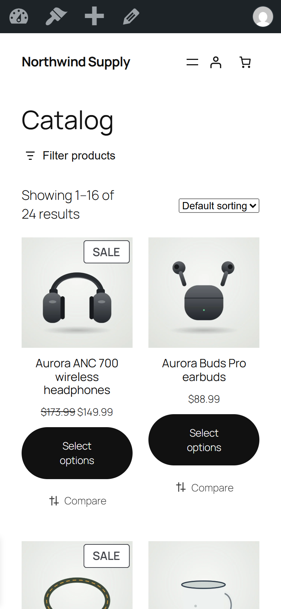
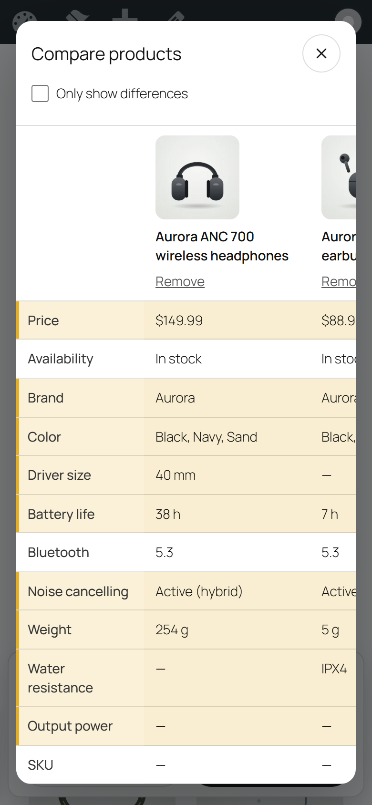

# Supplier Sync for WooCommerce

[](https://github.com/manch1915/woo-supplier-sync/actions/workflows/ci.yml)

A WordPress plugin that keeps a WooCommerce catalog in sync with suppliers. It reads YML and XML feeds, CSV and Excel price lists, JSON APIs and plain supplier websites, then creates and updates products, prices, stock, photos, attributes and variations on a schedule.



## What it does

Each supplier gets its own profile: where the feed lives, which column holds what, how its attributes and categories map to yours and which fields it is allowed to overwrite. A preview reads the first rows with the settings you have on screen, so you see the products before the first run.

The plugin reads YML (the Yandex Market format, including the off-spec feeds real suppliers send), any XML through XPath, CSV with delimiter and encoding detection (Windows-1251 too), XLSX, JSON APIs with nested fields and API keys in headers, and plain supplier websites through CSS selectors.

When two suppliers sell the same product, it is matched by EAN and then by the manufacturer's SKU. Stock adds up, the cheapest supplier that has it in stock sets the price, and the supplier that brought the product first keeps its title, text and photos. Offers that share a model or `group_id` become one variable product, and the attributes that differ between them (colour, size) become variation attributes.

Other things it handles:

- markup rules by supplier, category and cost range, with a fixed add-on, a minimum margin, rounding to 90, .99, .90 or whole numbers, and manual exchange rates; a calculator next to the rules shows the effect of unsaved edits
- what to do when nobody has a product left: keep it visible as out of stock, hide it from the catalog or move it to drafts; "on order" offers become backorders
- photos downloaded in the background, resized and stored as WebP, once per image even when two suppliers send it under different URLs
- big feeds: a run is a chain of short Action Scheduler jobs with a time budget, and offers whose hash did not change are skipped; the readers stream, so a 29 MB YML file with 50,000 offers parses in about 3 seconds with 2 MB of peak memory (PHP 8.3, desktop CPU)
- dry runs that list every product that would change, with old and new values side by side, and apply them in one click
- a safety brake: if more than 30% of a supplier's offers disappear at once (the limit is configurable), nothing is taken off sale and the run explains why
- a log of every created, updated and unpublished product, and a summary in Telegram or by e-mail after each run
- a "Compare" toggle on product cards (up to 4 products, rows that differ are highlighted) and attribute filters built on the core WooCommerce Product Filters blocks
- WP-CLI commands for system cron, HPOS compatibility, English and Russian









<p>
  
  
  
</p>

## Try it

You need Docker. One command starts WordPress 7, WooCommerce 11, the plugin and three made-up suppliers:

```bash
docker compose up -d
```

The first start takes a few minutes: it builds the admin app, installs WooCommerce, imports last week's catalogs and downloads the photos. Follow it with `docker compose logs -f setup`.

| | |
|---|---|
| Store | http://localhost:8080 |
| Plugin | http://localhost:8080/wp-admin/admin.php?page=supplier-sync |
| Demo login | `demo` / `demo` (can run syncs and dry runs, cannot edit suppliers or prices) |
| Admin login | `admin`, the password is printed in `docker compose logs setup` |
| Supplier feeds | http://localhost:8081 (YML, CSV and the Volta website) |

The three suppliers are fictional and live in [`demo/feeds`](demo/feeds):

- **Nordline Distribution**, electronics, YML in rubles. The setup imports last week's file and then switches the profile to the current one, so the first dry run has real changes to show: a price drop, a colour back in stock, a new colour, a new product and a discontinued camera.
- **Pinecrest Outfitters**, outdoor gear, CSV in euros with semicolons and decimal commas. Jackets come in colours and sizes and turn into variations.
- **Volta Gadgets**, a small website with two catalog pages. Four of its products have the same EAN as Nordline's, so they merge into existing products: stock adds up and the cheaper price wins.

## How a sync works

A run moves through five phases. **Fetch** streams the feed to a private folder in uploads, or crawls the supplier site into a JSON Lines file. **Parse** reads it with a streaming reader (XMLReader, `fgetcsv`, a ZipArchive-based XLSX reader) into a staging table, a few hundred rows at a time. **Apply** takes one product at a time: it loads the offers of every supplier for it, merges them by EAN or SKU, prices them, builds the desired product and compares it with the current one. A dry run stops there and logs the difference; a live run writes only the fields that changed through the WooCommerce CRUD API. **Sweep** handles offers that disappeared from the feed, behind the safety brake. **Finish** writes the counters, sends the report and starts the next queued run.

Each phase works for about 20 seconds, saves its cursor in the run row and queues its own continuation in Action Scheduler. Runs go one at a time because two suppliers can touch the same merged product. The domain layer (offers, pricing, merging, diffing) is plain PHP without WordPress and is covered by fast unit tests; the WordPress side is covered by integration tests against a real WooCommerce install.

```
plugin/
  src/Domain/          offers, price rules, merging, product drafts, diffing (no WordPress)
  src/Feed/            YML, XML, CSV, XLSX, JSON readers, CSS-to-XPath, page parser
  src/Infrastructure/  custom tables, WooCommerce writer and reader, images, HTTP, settings
  src/Sync/            run state machine, scheduling, preview
  src/Rest/            REST API for the admin app
  src/Storefront/      comparison API and blocks
  src/Cli/             WP-CLI commands
  assets/src/admin/    React + TypeScript admin app
  assets/src/blocks/   comparison blocks (Interactivity API)
demo/                  fake suppliers, Docker setup script, image generator
```

## Supplier formats

| Type | Read with | Notes |
|---|---|---|
| YML | XMLReader | `vendorCode` as SKU, `barcode` as EAN, `param` with units, `group_id` for variations, stock from `count`, `quantity`, `stock` or `outlets` |
| XML | XMLReader + XPath per field | for any `<product>`-style export |
| CSV | `fgetcsv` | delimiter detection, Windows-1251, decimal comma, images split by `,` `;` `|` |
| XLSX | ZipArchive + XMLReader | first sheet, shared strings, no extra libraries |
| JSON | `json_decode` | dot paths such as `pricing.net`, an object of attributes, request headers for API keys |
| Website | WordPress HTTP API + DOM | listing pages, pagination, product pages; stays on the host, follows robots.txt, waits between requests |

The plugin has no runtime Composer dependencies, so it cannot clash with another plugin's copy of a library.

## WP-CLI

```bash
wp supplier-sync list
wp supplier-sync run 2 --dry-run
wp supplier-sync run all
wp supplier-sync status 41 --action=updated
wp supplier-sync import-profiles suppliers.json
wp supplier-sync import-images
```

On a server, replace WP-Cron with a system cron entry:

```
* * * * * wp --path=/var/www/html action-scheduler run --quiet
```

## Development

```bash
cd plugin
composer install
npm ci
npm run build             # admin app and blocks
vendor/bin/phpcs          # WordPress Coding Standards
vendor/bin/phpstan analyse
vendor/bin/phpunit --testsuite unit
npm run lint:js && npm run typecheck
```

Integration tests need a database and a WordPress copy with WooCommerce; see [`.github/workflows/ci.yml`](.github/workflows/ci.yml) for the exact steps. The demo product photos are drawn in code: `cd demo/tools && npm install && npm run images`.

Requirements: PHP 8.2+, WordPress 6.8+, WooCommerce 9.2+ (tested with WordPress 7.1 and WooCommerce 11.2), the `zip` extension for XLSX and GD or Imagick with WebP for photo conversion.

## Security notes

- Every REST route checks one of three capabilities: view, run or manage. The demo role can run syncs but cannot change sources.
- Feeds are fetched with `wp_safe_remote_get`, so private network addresses are refused. API key headers never leave the server, are not sent to another host on redirect, and are dropped if the feed URL moves to another origin.
- Downloaded feeds contain purchase prices and are stored in a folder closed to the web, then deleted after the run.

## License

GPL-2.0-or-later.
